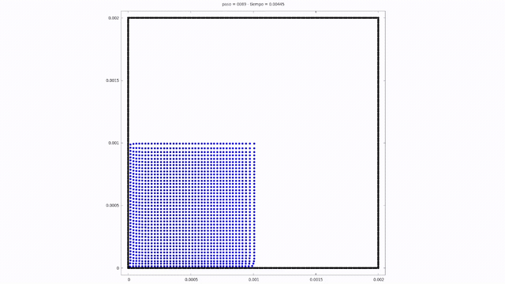
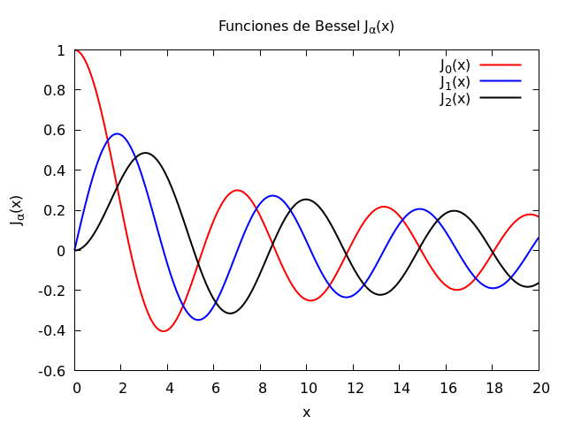
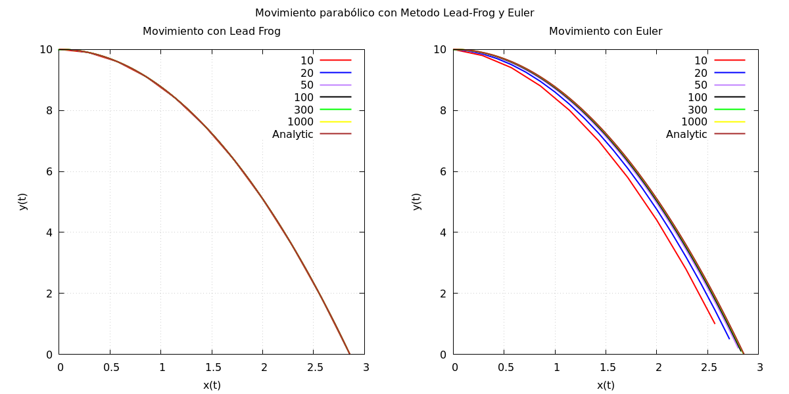
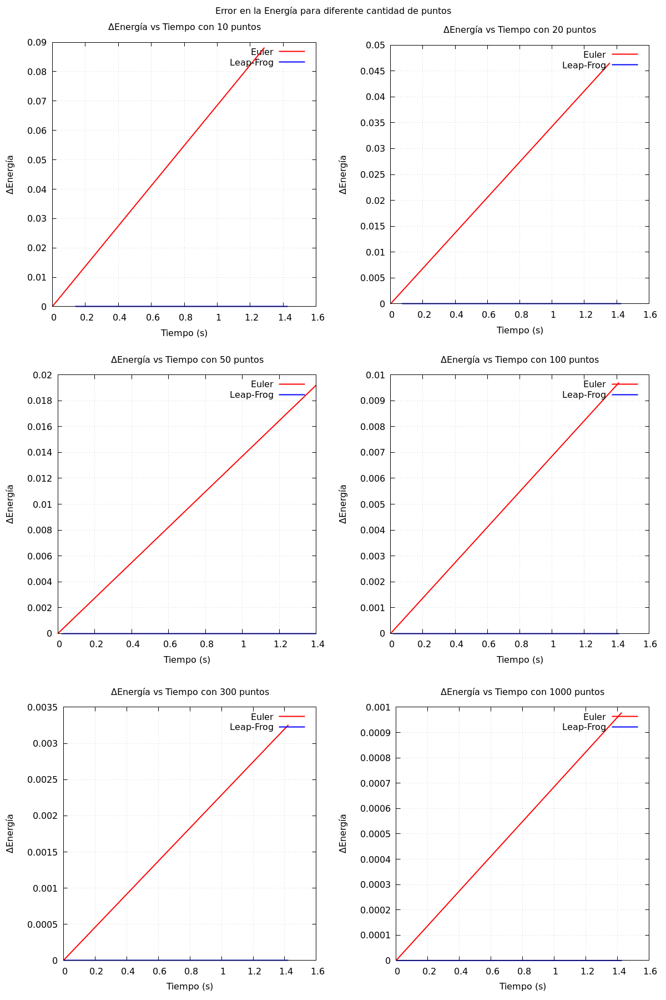
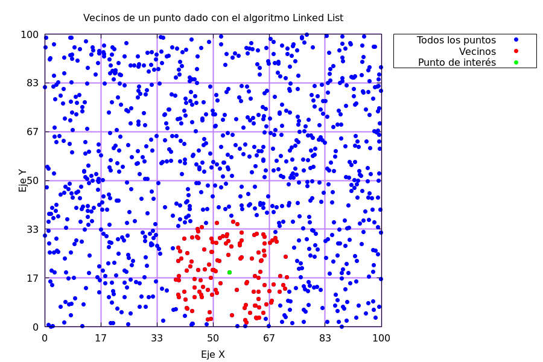

# Computational Astrophysics

Every result below was computed by programs written in C.

## SPH dam break

A water column collapses inside a box. Smoothed particle hydrodynamics. Playback is 12× faster than the original run.

## Bessel functions

\(J_0\), \(J_1\), and \(J_2\) from the Taylor series.

## Parabolic motion

Leap-Frog and Euler compared with the analytic trajectory.

## Energy error

Leap-Frog holds the energy. Euler drifts, less so as the step gets smaller.

## Linked-list neighbors

Neighbors of one point, found with a cell linked list.

